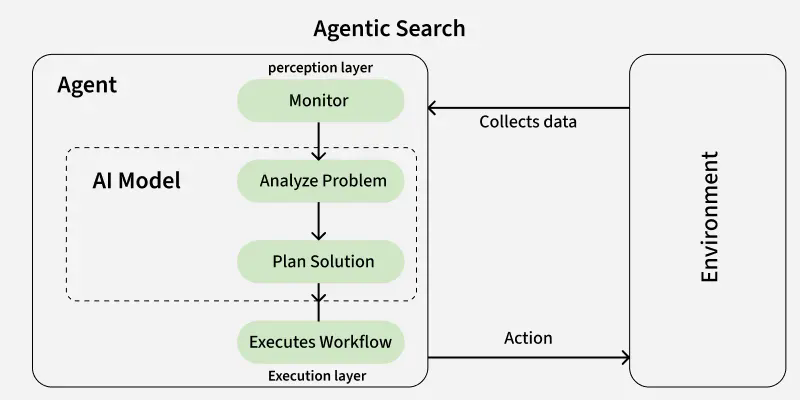

**Abstract**:

LLM-based agents increasingly operate as teams, in which planners, workers and critics exchange messages and share inference servers, files and tools. When such a workload violates its service-level objective (SLO), operators must determine which agent's action caused the violation. Existing eBPF-based tools correlate LLM interactions with system actions through a single agent's process lineage (AgentSight) or through kernel-resident label propagation (AgentLoupe). They are validated by case studies without ground truth, and they cannot attribute violations that propagate across agents, across nodes, or through contention on shared resources. We propose an application-transparent observability framework that reconstructs cross-agent causal graphs from eBPF-captured TLS plaintext and process events. The core idea is to treat causality as typed edges, across message, shared-state, delayed and contention channels. The framework links hops between agents by matching plaintext at both endpoints, attributes queueing delay at shared inference servers to the requests in service, and records cheaply by default, escalating to full capture when an SLO burn-rate trigger fires. It shows the observer LLM only the relevant subgraph rather than raw events. This report is a design proposal: a concrete starting point on which to iterate. What we have built is a small prototype testbed, a three-agent workload with seeded fault injection and a complete ground-truth log, which fixes the evaluation protocol and the oracle the framework will be graded against.

**Keywords**:

*distributed systems*, *multi-agent systems*, *observability*, *fault injection*, *eBPF*

## 1. Introduction

### 1.1 Motivation

Telecom operators are increasingly moving to offering **computing-on-demand** services: network functions and applications run as microservices over shared, geo-distributed infrastructure spanning cell sites, edge clusters, regional data centers, and the core cloud. With this increase in scale they are also looking to place agentic AI in important control loops across this infrastructure.

Millions of people depend on the reliability of these operations, so operators must be able to monitor, and bring reliability to, inherently non-deterministic agentic workflows. This calls for an observability framework capable of detecting, localizing, and explaining failures that arise in large, distributed, multi-agent systems.

Using agents in systems of such importance also introduces new costs that must be managed: token limits, context-window sizes, the latency inherent to LLM calls, and more. A single task often needs many LLM calls, so cost and energy matter, which argues for local or small models. Current research is still establishing the costs and faults of such systems.

Two questions follow for an operator. Which agent's action caused an SLO violation, and did a claimed action really happen?

### 1.2 Problem statement

The objective is to design a framework that 

1. recovers cross-node causal links between agents, infrastructure effects and SLO outcomes, 
1. collects eBPF telemetry adaptively, so that cost stays low until an SLO is at risk, and 
1. verifies outcomes, that is, checks that what an agent claims to have done is what happened.

**NOTE**: We currently only focus on observing the agentic workload. A typical computing-on-demand platform is also going to have many containers running conventional workloads that must also be observed alongside in this system. 

### 1.3 Challenges to Classical Observability

**Dynamic Call Graph**: A trace assumes a request flows through a known set of services. Here, the sequence of tool calls is chosen at run time by the agent and differs on every invocation. There is no fixed span tree to instrument.

- the community has converged on auditing the actual system actions of an agent rather than trying to instrumenting the agentic application, which leads to the semantic gap that is bridged by AgentSight

**Delayed and Cross-Process Effects**: When an SLO is violated, was it the UPF, or was it the agent's decision to scale down forty seconds earlier? Conventional traces cannot connect a decision to a delayed, indirect, infrastructure-level effect.

- AgentLoupe attepts to solve this by assigning kernel labels to persistent files affected by agent decisions so ensure attribution in the future

**Non-determinism** destroys baselining. Anomaly detection over trace shape or latency distribution assumes repeatable structure. Two correct runs may look nothing alike.

- This makes ground-truth verification so important

**Invisible Root Cause**: A regression caused by a changed prompt, a stale retrieved document, an ambiguous tool description, or a truncated context window is completely invisible in CPU, memory and packet counters

- We must be able to localize the source of the error in such cases even if we can't explain the root cause

**Silent failure**. An agent can take a plausible but wrong action while every conventional health signal stays green. There is no counterpart to "HTTP 500" for a bad decision.

- In the event of an SLO violation we must be able to attribute the violation back to this bad decision

**The observer effect**: Agents consume observability data as input. The telemetry pipeline is therefore inside the control loop: what we sample, how stale it is, and how we summarise it directly changes what the agent does. Classical observability assumes a passive human consumer looking at a dashboard. That assumption no longer holds

- Increasingly people are turning towards an AI observes AI framework, and we can not ignore what we show the observer LLM and its own overhead

### 1.4 Current Research questions

- **RQ1**: What is the right unit of observation for an agentic control plane, one that spans a reasoning step, the tool invocation it produced, and the kernel- and network-level effects that followed?
- **RQ2**: How do we construct a causal record linking an agent decision to its downstream infrastructure effects, when those effects are delayed, indirect and partially observed, at an overhead the data plane can absorb?
- **RQ3**: Can telemetry collection be co-designed with agent consumption? That is, instead of asking how to optimise the agent, we ask how to optimise what the agent is shown: adaptive, cost-aware eBPF instrumentation driven by what the agent currently needs to decide.
- **RQ4**: Can we replay a non-deterministic decision, and answer counterfactuals about what would have happened under a different action?

How this report addresses them: 
- RQ1 is answered by a proposed *decision span*
- RQ2 is the core of the linking and storage design and is graded by the testbed
- RQ3 is the adaptive-collection and observer-input design 
- RQ4 is scoped narrowly: the testbed supports seeded, rerun-based counterfactuals as a grading oracle, and replaying a decision inside a live system, or estimating a what-if on a captured graph, is future work.

### 1.5 What Gap does this Fill

**AgentSight**: correlates TLS-intercepted LLM traffic with kernel events using a real-time engine and a secondary observer LLM. 

- Its demonstrations are weak case studies (prompt injection, reasoning loops, a multi-agent coordination bottleneck)
- no ground truth verification
- and the cost of the secondary LLM is unquantified

**AgentLoupe**: motivated by the observation that AgentSight fails for delayed execution and cross-lineage behaviour. 

- It keeps causal labels in kernel eBPF maps, which makes it per-host by construction. 
- Its abstract reports some case studies (delayed cron-triggered reverse shell)
- but no accuracy against ground truth.

**llmmas-otel**: application-level OpenTelemetry instrumentation with a fault-injection layer

- not eBPF, can't handle the delayed execution faults
- and it needs access to the agent code.

Nobody specifies or measures what the observer LLM is shown, or adapts collection to what the consuming agent needs (RQ3). None of these works evaluates against a ground-truth log in which every effect of an injected fault is labelled. This is what our testbed provides. AgentSight and AgentLoupe are also limited to single-host systems and can't be directly extended to large distributed systems

### 1.6 Deliverables

1. A unit of observation, the decision span, and a failure model that types causal edges by propagation channel, with a promise matrix of what the framework will and will not claim.
2. A framework design that links agents without application instrumentation, attributes shared-server queueing, and escalates collection on SLO burn, and that shapes what the observer agent is shown.
3. A seeded, fault-injected multi-agent testbed with hash-joinable ground truth, used as the grading oracle and as the basis for rerun-based counterfactuals. 
4. An analysis of the opportunities and risks of using AI to observe AI (further research questions), an evaluation protocol with baselines, metrics and a measured noise floor, and engineering findings on running AgentSight with local models.

### 1.7 Scope and non-goals

- Agentic workloads only, classical workloads are ignored for now
- Silent failures are to localized but explaining them may be out of scope (think model failures, hallucinations, etc)

## 2. State of Agentic AI Research

### 2.1 Agent architectures and frameworks

Agents are commonly built as a loop in which a model picks an action (a tool call or a final answer), the runtime executes it, and the result is fed back. Multi-agent systems compose such loops: planner/worker/critic, debate, and pipelines[^1]. Our prototype testbed uses the first pattern, with a planner that retries a worker when a critic rejects its result (§6.1), because it produces fan-out, retries and shared-resource contention with very little code. We deliberately avoid agentic applications (opencode/claudecode/openclaw) so that all behaviour is traceable and visible on the wire.



### 2.2 Communication and tool protocols

MCP standardises how agents reach tools[^2], and A2A how agents reach each other[^3]. Both run over HTTP, so what an external observer can see depends on TLS visibility, streaming, and connection reuse. Our prototype testbed uses plain JSON over HTTPS between agents. 

At the moment we assume access to very basic tools (1) file reading, (2) file writing, (3) and limited shell access.

### 2.3 Serving and runtime

Agent workloads issue many dependent LLM calls to shared inference servers. Parrot (OSDI '24) argues that the unit to optimise is the LLM application, not the single request, and uses a "semantic variable" annotation to expose the data flow between requests. Autellix schedules at the level of the whole agent program, observing that head-of-line blocking at both the request and program level drives long waits, and reports 4–15× higher program throughput at equal latency than vLLM. Both systems get program-level context from the application or the client. An external observer has neither, which is why our design must recover it from the wire.

A shared server is also a contention point: with one decode slot, requests queue, and one agent's burst delays another's calls without any message between them. This contention channel is important to our failure model, and Autellix's point implies that the order in which a server serves requests (FIFO or not) changes who gets blamed.

### 2.4 Failures and reliability of agent systems

*MAST* (NeurIPS 2025) builds a taxonomy of 14 failure modes in three categories from 1,642 annotated execution traces across seven frameworks, and argues that failures often stem from system design and inter-agent misalignment, not only from model limits. *Who&When* (ICML 2025) defines automated failure attribution, finding which agent and which step caused a failure, on logs from 127 multi-agent systems. Its best method reached 53.5% accuracy on the responsible agent but only 14.2% on the failing step, and some methods did worse than random. The low step-level figure motivates grading attribution against ground truth. It also requires needing to simplify the view presented to an overseeing LLM from just raw logs, simply adding a causal relation between decisions alone might make a significant change to this number.

### 2.5 Local and small models

Small local models are cheaper and keep data on-premises, but tool calling is less reliable and context windows are limited. Our own data: a single-agent ticket classifier on `qwen2.5` with schema-constrained JSON actions classified 20 of 20 tickets correctly, while the same task through the off-the-shelf `opencode` harness succeeded in under 5% of attempts. The opencode requests we captured carry an 18,005-character system prompt plus 8,826 characters of tool schemas (about 6.7k tokens by the rule), against a 16k-context model variant. 

That size alone does not explain the failure, since it fits within the context window; a possible cause could be that Ollama's OpenAI-compatible endpoint ignored the larger context setting. Unable to get opencode to work so far, we therefore use a minimal harness with schema-constrained output.

### 2.6 Agents in infrastructure operations

Network and cloud operations are adopting agents for triage, configuration and remediation. These loops act on shared infrastructure, so a wrong or slow action propagates, which is why operators need to know both what an agent did and what it caused.

### 2.7 AI observing AI

A visible trend in this literature is to use LLMs to observe, evaluate and explain other LLM systems. *AgentSight* uses a secondary LLM to bridge the semantic gap between an agents intent and its actions. *MAST* annotates traces at scale with an LLM-as-a-judge pipeline. *Who&When* asks LLMs to name the responsible agent and step. In cloud operations, LLM agents (RCAgent, and agents studied for root-cause analysis more generally) read logs, metrics and traces to propose root causes; RCAgent is hosted internally because incident data is sensitive.

**What it solves.**

- *The semantic gap.* Rules and counters see bytes, syscalls and latencies. Only a model can read a prompt and say what the agent was trying to do, or whether a retry was a reasonable reaction to a rejection.
- *Unstructured volume.* Prompts, transcripts and tool outputs are free text that fixed parsers cannot cover, and they change whenever the agents change.
- *Explanation.* Operators need a readable account of a failure, not only a graph, and a model can write one.
- *Gaps in the deterministic edges.* Where a hash match or a propagated ID is absent, a model can propose a semantic link (labelled as such, §5.2).

**What it costs.**

- *The observer is itself unreliable.* The same results that motivate the approach show how weak it is: step-level attribution of 14.2% on Who&When, and, in cloud RCA, reported problems with randomness and hallucinated actions (the Flow-of-Action work adds a judge agent for this). An observer that is wrong with confidence is worse than none.
- *It consumes the resource it observes.* On a shared inference server, the observer's own calls queue behind, and in front of, the agents' calls. Its load changes the SLOs it is meant to explain (an observer effect), and its tokens are an overhead that no paper quantifies so far.
- *Context limits.* A small model cannot read long raw event streams, which is why selects a subgraph.
- *Untrusted input.* Captured prompts and tool outputs are attacker-influenced text. Feeding them to the observer exposes it to prompt injection from the very system it audits.
- *Shared blind spots.* An observer from the same model family may fail in the same way as the agents it watches.
- *Privacy.* TLS plaintext capture exposes prompts and data, which argues for a local observer.
- *Grading.* Without ground truth, "the observer found the cause" cannot be checked, and the observer's output may only look plausible.

**Our Proposition**: Build the graph deterministically (hash matching, process lineage, queue position) and let the LLM only rank and explain on a bounded subgraph; run it on a local small model off the real-time path; count its tokens and queue load as overhead; treat captured text as untrusted data; and grade its conclusions against the testbed's fault-tagged ground truth. This is what makes the observer's answers testable, and it frames RQ3.

### 2.8 Operating-system support for agents

A parallel line of work asks what the operating system itself should offer agents. Several of these authors also worked on AgentSight. Most of it concerns control, isolation and interfaces, not observation, but the papers below bear on our research questions. I initially spent time on these papers before our domain shifted to observability.

- **AgentCgroup** characterises the OS resource use of sandboxed coding agents over 144 software-engineering tasks, then controls it with an intent-driven eBPF resource controller that creates an ephemeral child cgroup for each tool call. Enforcement is in the kernel, and the preliminary evaluation reports 29% lower high-priority p95 latency under multi-tenant memory contention. *Relevance:* it makes the **tool call** the boundary at which resources are accounted, which supports our choice of a decision span (RQ1) and gives a natural place to attribute resource effects (RQ2).
- **Fork, Explore, Commit** introduces the *branch context*: a copy-on-write filesystem view plus a process group with a fork, explore and commit-or-abort lifecycle (BranchFS, and a proposed `branch()` syscall; branch creation under 350 μs). *Relevance:* isolated, rollback-able state is the mechanism one would need to **replay a decision from the same state and try a different action** (RQ4). Our seeded reruns achieve this at whole-run granularity; branching would do it per decision inside a live system.
- **AgentPProf** argues that agent observability needs *profiling*, not only per-run debugging: it aggregates trajectories into pprof-compatible profiles using "operation stacks" and recursive segmentation at task boundaries. It names a problem we share: agent activity lacks stable identifiers to aggregate on. *Relevance:* it is cross-run and cost-oriented, where our work is per-incident and causal; the two are complementary, and its identity problem is RQ1/RQ2.
- **When Agent Context Goes Stale** shows that an agent keeps a tool observation (for example a file's contents) in context after another agent, a user or a tool has changed the source, and then reasons from outdated facts. Its framework, Concord, links each observation to its source and detects changes. *Relevance:* this is exactly our **shared-state and delayed channel**: the cause (a write by one agent) and the symptom (a wrong decision by another) are separated in time and have no message between them.
- **Towards Agentic Performance Management** proposes performance interfaces that answer *counterfactual queries* ("my SLO is violated; which reallocation would restore it?") using queueing models, learned predictors and approximate simulators. *Relevance:* it is the model-based version of the counterfactual claim we deliberately postponed in §5.3, where we use reruns as an oracle and not an estimate; it also takes SLO violation as the entry point, as we do.
- **Grimlock** uses the same vantage point, eBPF interception of agent-to-agent TLS traffic, to *enforce* identity and scope on delegation, showing that this position suits control as well as observation. 

None of these provides a causal record across agents or a ground-truth evaluation of attribution, so they strengthen the case for RQ2 and RQ4 without covering them.

## 3. Background: observability in distributed systems

### 3.1 Tracing basics

Dapper introduced spans, trace IDs and sampling. Its central requirement is context propagation: every hop must carry the trace ID. In multi-agent LLM systems that requirement often fails, since agents are third-party code and LLM calls are black boxes, which is why we start from inferring links rather than assuming propagation.

### 3.2 Causality and time

Happened-before (Lamport) orders events by causal dependence, not wall-clock time. Across hosts, clocks drift and skew, so per-host timestamps cannot be compared directly. Our testbed sidesteps this by using one `CLOCK_MONOTONIC` on a single machine, and §7.9 proposes injected clock offsets to test the design under skew.

### 3.3 Zero-instrumentation tracing

eBPF can observe process events and TLS plaintext (by hooking the TLS library's read and write calls) without modifying applications. DeepFlow (SIGCOMM 2023) is a network-centric tracing system that uses predefined kernel hooks for automatic instrumentation of microservices, with no application code changes, and reports production use at several companies. It infers links from network signals, which is the model we adapt, with the addition that agent messages have content that can be matched. Hooking TLS reads and writes only works when the application's own traffic is visible as plaintext at the library, which is why every hop in our testbed uses real HTTPS over localhost sockets.

### 3.4 Sampling and collection strategies

Head sampling decides up front, tail sampling decides after the trace completes, and retroactive sampling (Hindsight, NSDI 2023) records all trace data locally and reports it only after a trigger fires, like a dash-cam that persists footage after a jolt. After a trigger, a coordinator contacts the machines that served the request and follows breadcrumbs left on each. Hindsight is compatible with OpenTelemetry instrumentation and reports nanosecond-level overhead to generate trace data. Our adaptive design (§7.5, §7.7) follows the retroactive model, but triggers on SLO burn and on what the consuming agent needs (RQ3).

### 3.5 Root-cause analysis

A causal-inference RCA benchmark study motivates not relying on statistical causal discovery alone for service graphs. In our setting the graph is not unknown: it is reconstructed from message matching, and statistics are used only for attribution along edges. [Reading status and gaps: author to complete.]

## 4. Related work: agent observability

### 4.1 AgentSight

AgentSight (arXiv 2508.02736) introduces *boundary tracing*: it watches agents from outside their code, at stable system interfaces, with eBPF. It intercepts TLS-encrypted LLM traffic to recover intent, monitors kernel events for system-wide effects, and correlates the two across process boundaries with a real-time engine and a secondary LLM. It works on closed-source CLI agents without an SDK or proxy. It demonstrates prompt-injection detection, resource-wasting reasoning loops and a coordination bottleneck in a multi-agent system, and reports under 3% overhead. From the full text (the abstract does not say): correlation uses process lineage, temporal proximity and argument matching, with a 100–500 ms window that is not justified; there is no ground truth; the multi-agent evidence is one qualitative session; and overhead is reported from three runs as a mean. [author's reading of the full paper; to re-verify]

### 4.2 AgentLoupe

AgentLoupe (arXiv 2610.23233) targets what AgentSight misses: delayed execution and behaviour that crosses process lineages. It captures TLS plaintext to interpret LLM interactions, gives each a *kernel-resident semantic label* kept in eBPF maps, and propagates the label across processes and threads and onto kernel resources such as files and sockets, so that a persistent resource carries the context to an unrelated process later. It reports average overhead below 8% and case studies tracing cross-lineage persistent attacks to their originating LLM interactions. The abstract reports no accuracy against ground truth. [to verify in the full text: single-host scope, how it decides that a prompt is new, and label scoping]

### 4.3 llmmas-otel

llmmas-otel (arXiv 2608.24271) is a lightweight, framework-agnostic tool for inspecting and testing LLM-based multi-agent systems in software engineering. An OpenTelemetry observability layer records phases, agent steps, inter-agent messages, tool calls and LLM invocations. A fault-injection layer applies targeted faults at those interaction points, tags the affected spans (for example `llmmas.fault.injected` and a fault type such as an agent-to-agent delay), and compares baseline and faulty runs through aligned traces. It is validated initially on a minimal demo workflow and on one real multi-agent system for software development. It requires application-level instrumentation. Its fault-tagging idea is close to our `fault_id` ground truth; the difference is that ours is a side channel hidden from the observer, and our faults include resource contention. [fault list: to verify in the full text]

### 4.4 Failure attribution from logs

Who&When and MAST attribute failures from logs and transcripts after the fact, using human annotation and LLM judges. They do not observe from outside the agents and do not use infrastructure signals.

### 4.5 Comparison table and positioning

Columns follow §1.3. Entries marked "?" need verification against each paper.

| system | zero-instrumentation | multi-agent | cross-host | ground truth | overhead measured | adaptive | local-model support |
|---|---|---|---|---|---|---|---|
| AgentSight | yes | one session | no | no | time (under 3%) | no | ? |
| AgentLoupe | yes | cross-process, same host | no (kernel labels) | no | time (under 8%) | no | ? |
| llmmas-otel | no (OpenTelemetry) | yes | ? | partly (injected faults tagged) | ? | no | ? |
| Who&When / MAST | n/a (post hoc) | yes | n/a | annotated | n/a | n/a | n/a |
| **This work (proposed)** | yes | yes | emulated | yes (testbed) | time and tokens (planned) | yes | yes (design target) |

Note: earlier work predates AgentSight and is lower impact.

**Relation to the AgentSight line of work.** Several of the OS-for-agents papers of §2.8 share authors with AgentSight (AgentCgroup, the branch context and AgentPProf), and AgentPProf is released in the AgentSight repository, so they are best read as one research programme extending AgentSight towards resource control, state isolation and cross-run profiling. Our work builds on AgentSight's boundary-tracing vantage point but extends it along a different axis: causal attribution across agents and shared resources, graded against a ground-truth log that the existing papers lack.

## 5. Failure model and causal framework

### 5.1 Failure model

**Unit of observation (RQ1).** Existing tools pick a unit from one layer: an LLM call (prompt level), a syscall or process (kernel level), or a request (network level). We propose a **decision span**: one reasoning step (an LLM call, with its prompt and response), the tool invocations that response produced (file, process and network actions), and the downstream effects those actions had, including delayed ones and ones on shared resources. A span has an identity (here, derived from content hashes and process lineage rather than an injected ID), a start and end, and typed links to other spans. In the testbed, one worker `llm_start`/`llm_end` pair, the `write_file` `tool_call` it triggers, and the response message that carries the written result onward to the critic form one decision span, which the ground-truth log lets us enumerate exactly. The testbed has no delayed shared-state link yet (§6.4), so the delayed part of the span is untested.

A failure is a triple: **root cause**, **propagation channel**, **symptom**. The symptom is an SLO violation or an incorrect outcome, and the root cause is a decision span (or an injected fault acting on one).

- **Root causes:** model failures (hallucination, loops, truncation), resource (CPU, inference queue, context size), tool or state (slow or wrong tool, stale file), message (malformed or lost), coordination (a reviewer that rejects, a retry storm).
- **Channels:** message (A sends to B), contention (A and B share a resource, no message between them), shared state (files, databases), delayed or persistent (effects that appear later), and semantic (the content of an answer influences a later decision).

### 5.2 What the framework claims

Two things. **Provenance**: the happens-before relation between observed events. **Attribution**: how much of a symptom to blame on each upstream event along the edges. Edges are labelled by how they were established: **exact** (hash matched at both endpoints, or propagated ID), **inferred** (timing, ordering, queue position), and **semantic** (content containment).

### 5.3 Counterfactuals (RQ4)

We take position (a) for RQ4: counterfactual runs in the testbed are the **grading oracle**, not a feature of the framework. Because runs are seeded, rerunning the same seed without a fault yields the fault-free outcome, so a fault's true effect on each ticket is a difference of two runs, and we can score a framework's blame against it. Replaying one non-deterministic decision inside a live system, or estimating a what-if on a captured graph, is a different and harder claim (§7.6) and is left to future work.

### 5.4 Promise matrix

The matrix lists, for each testbed fault (§6.4), its channel and the claim the framework is designed to make. These are design targets. The rightmost columns are filled with measured results once the framework exists (§8).

| fault | root-cause class | channel | detect | localize | explain |
|---|---|---|---|---|---|
| `burst` (worker/critic) | resource | contention | yes | yes (blame the in-service requests) | yes |
| `context_bloat` | resource | contention | yes | yes | partial (prompt size visible, intent not) |
| `slow_tool` | tool | local delay | yes | yes (gap inside one agent) | partial |
| `reject_loop` | coordination | message | yes (retries) | yes | partial (reason is a forced override, not visible) |
| `bad_output` | model | semantic | partial | partial | out of scope without a judge of correctness |
| `cpu_hog` | resource | contention (host CPU) | out of scope on this setup | out of scope | out of scope |
| (not built) shared-state corruption | tool/state | shared state | design only | design only | design only |

Out-of-scope cells: `bad_output` detection needs a ground-truth notion of correctness, which an external observer lacks. `cpu_hog` had no measurable effect on this setup (§6.4), so there is nothing to detect. Both are reported, not hidden.

### 5.5 Timing and staleness

The observed system keeps moving while analysis runs. The framework therefore takes a snapshot at the trigger and keeps the LLM off the real-time path: capture and edge building run continuously, and the observer LLM is invoked on a frozen subgraph.

## 6. Testbed and ground truth

*This is the one implemented component, and it is a small demonstration prototype: three agents on one machine, one 7B-class model, twenty synthetic tickets per run, about 90 s per run. It is meant to make the design testable, not to be representative of production load. All numbers in this section were measured on it.*

### 6.1 Workload and topology

Three agents, each its own OS process, plus a shared Ollama server:

```
planner --HTTPS :9101 /task---->  worker --> Ollama
planner --HTTPS :9102 /review-->  critic --> Ollama
```

- **planner**: client and orchestrator with no server. It dispatches 20 synthetic support tickets (template-generated from the run seed, each with a known category label) with two tickets in flight, so requests overlap and the Ollama queue builds.
- **worker**: a threaded HTTPS server running a tool loop (`read_file`, `write_file`, `finish`) with schema-constrained JSON actions. It reads the ticket and the shared `policy.txt`, writes `result_<ticket>_a<attempt>.json` to a per-run sandbox, then finishes.
- **critic**: a threaded HTTPS server that does a deterministic schema check and one schema-constrained LLM verdict (`approve` or `reject`).
- The planner retries the worker (up to two retries) when the critic rejects, which produces retry loops and fan-out.
- Ollama runs with one parallel slot and one loaded model, so requests are served one at a time.

### 6.2 Communication

Every inter-agent and agent-to-Ollama hop is HTTPS over a real localhost socket (a `socat` TLS terminator fronts Ollama), so TLS-plaintext tracing can see all of it. Messages are single JSON request/response pairs, in the spirit of A2A. Not covered: streaming responses, HTTP/2, gRPC, and message brokers.

### 6.3 Model and context-window choices

We use `qwen2.5` (4.8 GB, fully on GPU) with temperature 0, an 8192-token context, a capped output length and a per-request seed derived from the run seed, ticket, attempt and step. Off-the-shelf agent harnesses did not work with a model of this size (§2.5): the `opencode` runs captured on the wire used about 27k characters of system prompt and tool schemas per request and succeeded in under 5% of attempts. A minimal harness with schema-constrained actions classified every ticket correctly (20 of 20 labels, in the single-agent version and in every multi-agent run we measured).

### 6.4 Fault injection

Faults are listed in a scenario file with a target agent, a start time and duration relative to a shared start `t0`, and parameters. Each agent reads the file and activates its faults by the clock; there is no control channel.

| group | fault | target | mechanism | parameters used |
|---|---|---|---|---|
| contention | `burst` | worker or critic | before each handled request, fire K extra junk LLM calls that queue in Ollama | K=3, 200 tokens |
| contention | `context_bloat` | worker | pad every LLM prompt with P tokens of filler | P=4000 |
| local delay | `slow_tool` | worker | `read_file(policy.txt)` sleeps D ms | D=8000 |
| local delay | `cpu_hog` (optional) | any agent | the runner spawns H busy loops pinned to the target's CPU | H=4 |
| behavioural | `reject_loop` | critic | force `reject` for the first R attempts of each ticket | R=1 |
| behavioural | `bad_output` (optional) | worker | write a wrong category on attempt 0 with probability p | p=0.5 |

Compared with llmmas-otel's boundary faults (LLM, tool, agent-to-agent), this adds resource contention at a shared inference server and a host-CPU fault. A shared-state fault (for example a corrupted or stale `policy.txt`) is not built yet and is the clearest gap against the failure model of §5.

Measured effect (seed 1, 20 tickets, concurrency 2, fault active from 15 s to 55 s), compared with three fault-free baselines:

| scenario | p95 e2e | retries | note |
|---|---|---|---|
| baseline (3 runs) | 8.7–9.1 s | 2 | spread about 0.4 s |
| `burst` on worker | 33.9 s | 2 | mean Ollama queue wait inside the window 5.3 s, vs 0.74 s |
| `burst` on critic | 34.8 s | 2 | |
| `context_bloat` | 22.4 s | 2 | |
| `reject_loop` | 15.7 s | 7 | |
| `slow_tool` | 14.8 s | 2 | |
| `bad_output` | 15.3 s | 5 | |
| `cpu_hog` | 9.0 s | 2 | no effect: agents are I/O-bound and the model runs on the GPU |

Each required fault changes either p95 or the retry count by at least 15 times the baseline p95 spread, or, for retries, from a baseline spread of zero. The in-window per-ticket figures rest on 4–12 tickets and are noisy, so we compare whole-run p95. The optional `cpu_hog` produced no effect, and we report it as a null result.

### 6.5 Ground-truth log

An application-level side channel, `ground_truth.jsonl`, written by every process. It is not visible on the wire: no ground-truth IDs travel in headers or bodies, so the observer must infer links. (An optional flag adds a W3C `traceparent` header for an ablation only.) Every event has the run, role, process id, and both a monotonic and a wall timestamp.

- **Messages:** the sender mints a `msg_id`; the receiver logs only the SHA-256 of the body, so edges are joined by hash. Bodies contain ticket and attempt, so they are unique.
- **LLM calls:** purpose (`work`, `fault_burst`, `fault_bloat`), prompt hash, client time, and Ollama's own timing fields.
- **Tool calls, task start/end, and per-ticket SLO records** with the label and the actual result.
- **Fault events:** every event caused by an injected fault (extra calls, sleeps, forced rejects, padding) carries that fault's id. This is the attribution ground truth.

A validator checks that every task has a start and end, every send has a matching receive by hash, every file write has a tool call, and every fault window is opened and closed. It passes on every run reported here.

One finding matters for the design. In the Ollama version used (0.40.11), `total_duration` already includes time spent queued in the scheduler, so the obvious queue-wait estimate (client time minus server time) measures only about 5 ms of client and TLS overhead. The real queue wait is the server's total minus its load, prompt-evaluation and generation time; we log it as `ollama_queue_ms`. Because these timing fields appear in the response body, an observer that sees TLS plaintext can in principle recover the same quantity. Across 100 overlapping request pairs from one baseline run, Ollama served requests strictly in arrival order (no service-order inversions), which supports the FIFO assumption in §7.3 on this setup.

### 6.6 SLO definition and reproducibility

- **SLO**: per-ticket end-to-end latency (dispatch to final approval or give-up) must not exceed `SLO_MS` = 1.5 × the mean baseline p95. From three baselines (p95 = 8.7, 8.9, 9.1 s), `SLO_MS` = 13.3 s. A ticket also violates the SLO if it is never approved. Whether the final label is actually correct is recorded separately.
- **Baseline**: about 90 s per run, 5.5 LLM calls per ticket, p50 7.1–7.4 s, p95 8.7–9.1 s, 2 retries. One ticket is rejected on all three attempts in every baseline run even though its answer is correct, so baseline retries are a deterministic feature of the seed, not noise.
- **Reproducibility**: the same seed gives the same ticket order, fault schedule and per-ticket outputs (checked across three baseline runs). Latencies differ and are not asserted on.
- **Paired runs**: a fault run and a baseline with the same seed differ only in the fault, which is what makes the counterfactual oracle of §5.3 possible.
- **Noise floor**: baseline p95 spread of about 0.4 s across three runs. This is a small sample and should be extended.

## 7. Observability framework design

*This section is a proposal. None of it is implemented yet.*

### 7.1 Overview and layers

Seven layers: (1) capture, (2) identity and clocks, (3) edge builders, (4) the causal DAG, (5) attribution, (6) adaptive collection, (7) the observer LLM. Capture and edge building run continuously and cheaply. Attribution and the observer LLM run on a snapshot when a trigger fires.

### 7.2 Capture

TLS-plaintext hooks (an `sslsniff`-style probe on the TLS library's read and write) and process probes (exec, fork, file open, connect). Each captured record carries process id, timestamps, direction and the plaintext chunk. We expect truncation of large bodies and loss under load, and the design must record when data was dropped so that missing edges can be told apart from absent causality.

### 7.3 Identity and linking

A linking ladder, from weakest to strongest assumption:

1. **Infer by default.** A request body seen leaving agent A and arriving at agent B hashes identically. This matches hops without any ID, which is the **exact** edge type (the testbed's hash-joined ground truth is exactly what grades it).
2. **Propagated ID if present.** If a `traceparent` header is on the wire, use it. The testbed's ablation flag tests how much this helps.
3. **Kernel labels within a host.** Process lineage links a process to its own LLM calls and file events.

Cross-node hops use the plaintext hash at both ends. **Semantic** hops (one agent's answer reappears inside a later prompt) use content containment, which is weaker and is labelled as such. [measure: containment precision and recall, TBD]

**Contention edges.** For a shared inference server, we propose that a request delayed by queueing is linked to the requests that were in service while it waited. With one slot and FIFO service (supported by §6.5), these are exactly the requests ahead of it, so blame can be split by the service time each consumed. The queue wait itself is read from the timing fields in the response plaintext.

### 7.4 The causal DAG

Nodes are decision spans (§5.1) and the events inside them: LLM calls, messages, and file or process events. Edges are typed (message, contention, shared state, delayed, semantic) and labelled (exact, inferred, semantic). It is a DAG, not a tree: a worker's call can be delayed by a critic's call and by the planner's earlier retry at once. Every event carries a causal id and a machine id so that cross-node merging does not rely on clocks.

### 7.5 Storage and retroactive collection

Record cheaply always (metadata, hashes, timing) and collect fully (plaintext bodies) when a trigger fires: an SLO burn-rate alarm or an error. On a trigger, follow breadcrumbs (the hashes and IDs recorded on every hop) to pull the related records by ID. The goal is to make the common case cheap and the failing case complete.

### 7.6 Replay (RQ4)

What can be replayed: the seeded testbed, because ticket order, fault schedule and per-ticket outputs repeat for the same seed, with temperature 0 and a per-request seed. Replaying a decision then means rerunning the seed and changing one thing (a fault on or off, or a different action forced at one step), which answers a counterfactual by observation, not by estimation. What cannot be replayed: free-form LLM non-determinism on other setups (a different hardware or server version can change a "deterministic" output), and external side effects. What the captured data must therefore contain for a real replay is the full prompt and response of the decision (available only after escalation, §7.5), the tool results it saw, and the model and sampling parameters. Replay inside a live system is future work; the claim here is limited to the testbed oracle of §5.3.

### 7.7 Adaptive telemetry (RQ3)

RQ3 asks for collection co-designed with what the consuming agent needs. We propose tiers of capture detail and triggers that move between them: for example, metadata only; metadata plus plaintext hashes; full plaintext and process events for one subtree. Two kinds of trigger move the tier: the system's (SLO burn rate, errors) and the consumer's (the observer agent states what it must decide, such as "was this retry caused by the critic or by the queue?", and collection is raised only for the spans that question touches). The overhead-versus-accuracy knob is the trigger threshold, and the cost counted includes the observer's own tokens and queue load (§2.7). [curve: TBD, §8.7]

### 7.8 The observer LLM (RQ3)

The observer is a local, small model, for the same cost, data-locality and privacy reasons as §1.1 and §2.7. It is shown a selected subgraph, not raw events: the path from the violating ticket back to candidate causes, with typed edges and per-edge timing. This matters because raw capture is noisy; in earlier AgentSight traces, a single `requests` call touched dozens of files, all attributed to the LLM call. [measure: events per LLM call and observer input tokens, TBD] The context budget is fixed in advance, and the prompt lists causes in a fixed structure so that answers can be scored against the fault ids. Captured text is passed as quoted data and never as instructions (§2.7), and the observer's ranking is never the only evidence: each blamed edge carries the deterministic reason it was built.

### 7.9 Emulating a distributed deployment

Network namespaces or containers on one machine stand in for nodes, and clock offsets are injected per node to test the design under skew. On a real cluster, link latency, clock drift and partial capture are worse than anything emulated here; that is a stated limit.

## 8. Evaluation

*The protocol below is fixed by the testbed. Results that need the framework are TBD.*

### 8.1 Setup, baselines, metrics

- **Baselines**: random blame; the AgentSight correlator; request-level critical path (blame the slowest span).
- **Metrics**: edge precision and recall per edge type; top-1 and top-3 root-cause accuracy against the fault ids in the ground truth; overhead; the noise floor from §6.6.
- **Oracle**: fault-tagged events and the paired fault-off run (§5.3).

### 8.2 AgentSight on our testbed

Run AgentSight against the testbed, bridge its output to the ground truth, count mismatches, and report correlator precision on real traces. Synthetic-data numbers are not cited as results. **TBD.**

### 8.3 Edge recovery and the decision span (RQ1/RQ2)

Edge precision and recall per type against the hash-joined message edges and the fault-tagged contention edges, and how often a reconstructed decision span matches the span enumerated from the ground truth. **TBD.**

### 8.4 Attribution against fault-on/fault-off ground truth (RQ2/RQ4)

For each fault in §6.4 and each seed, top-1 and top-3 accuracy of blamed cause, compared with the three baselines and with the paired fault-off rerun. **TBD.** The testbed's measured effect sizes (§6.4) bound what is detectable: `cpu_hog` has none on this setup.

### 8.5 Overhead (RQ2/RQ3)

Time and CPU, plus tokens and context size (neither AgentSight nor AgentLoupe reports tokens), over several runs with variance and not only means. **TBD.**

### 8.6 Observer input size and quality (RQ3)

Observer input tokens against events per call, the effect of subgraph selection on explanation quality, and the observer's own load on the shared inference server (its effect on the SLOs it explains). **TBD.**

### 8.7 Adaptive collection (RQ2/RQ3)

Always-on versus always-cheap versus adaptive, including consumer-driven escalation: cost, including observer tokens, against attribution accuracy. **TBD.**

## 9. Engineering findings on AgentSight and local-model support

### 9.1 Build and portability issues

- Clang inlining pushed a probe past the 512-byte BPF stack limit; fixed with `__noinline`. An issue was raised upstream.
- The probe linked against a hardcoded `readline` symbol in `/usr/bin/bash`. On this distribution, readline is a shared library, so the symbol is not in the bash binary and the probe prints `failed to find symbol 'readline'`.

### 9.2 Local-model gap

From reading the source: the provider list covers hosted providers; the LLM-path list has no Ollama native `/api/chat`; the token fields do not include Ollama's `prompt_eval_count` and `eval_count`; and Ollama streams newline-delimited JSON rather than server-sent events [to verify streaming]. Before claiming "no support", check whether Ollama's OpenAI-compatible `/v1` endpoint already works.

### 9.3 Proposed contribution

An upstream pull request adding native Ollama support and token fields. Scope and test plan: the testbed already produces the same calls with known timing and token counts, so it can serve as the test fixture. [to be written]

## 10. Discussion and threats to validity

- **This is a prototype.** One machine, a single small model, twenty synthetic tickets per run, three agents, and a handful of fault types. Results from it show feasibility and fix a protocol; they are not evidence about production systems.
- **The framework is unbuilt.** Section 7 is a design, and claims about it are hypotheses until §8 is filled in.
- **Small samples.** Three baselines and one run per fault give a noise floor of about 0.4 s p95. In-window per-ticket numbers rest on 4–12 tickets. Multiple seeds and more baselines are needed.
- **Inferred edges and FIFO.** Contention blame relies on FIFO service, which held across 100 overlapping pairs on this setup but is not guaranteed elsewhere.
- **Fault realism.** Faults are synthetic. `cpu_hog` had no effect, and no shared-state fault exists yet.
- **Observer faults.** Capture loss and truncation can break edges.
- **Out-of-scope cells** of the promise matrix (§5.4) are stated, not hidden.
- **Ground truth is ours.** The oracle shares code with the system under test; mistakes in the logger would be mistakes in the grading. The validator reduces but does not remove this risk.

## 11. Future work

- A real multi-host deployment.
- Mixed agentic and classical workloads: hundreds of containers with very different characteristics, shared contention between them, one platform for both (supervisor's point; mentioned only).
- A shared-state fault and other missing channels.
- HTTP/2, gRPC, streaming and brokers; learned adaptive policies; acting on attributions; larger models; semantic edges.
- Implementing the framework of §7 and filling §8.

## References

Citations are by name in the text. Entries below were checked against their arXiv or venue pages (abstract level only; full-text claims are marked in the text). Full bibliographic details are still to be added.

- **AgentSight**: Zheng, Hu, Yu, Quinn. *AgentSight: System-Level Observability for AI Agents Using eBPF.* arXiv 2508.02736.
- **AgentLoupe**: *AgentLoupe: Kernel-Resident Semantic Causal Labels for AI Agent Observability.* arXiv 2610.23233.
- **llmmas-otel**: *Observability and Fault Injection for LLM-Based Multi-Agent Systems in Software Engineering.* arXiv 2608.24271.
- **Who&When**: *Which Agent Causes Task Failures and When? On Automated Failure Attribution of LLM Multi-Agent Systems.* ICML 2025, arXiv 2505.00212.
- **MAST**: *Why Do Multi-Agent LLM Systems Fail?* NeurIPS 2025, arXiv 2503.13657.
- **Hindsight**: Zhang et al. *The Benefit of Hindsight: Tracing Edge-Cases in Distributed Systems.* NSDI 2023, arXiv 2202.05769.
- **Autellix**: Luo et al. *Autellix: An Efficient Serving Engine for LLM Agents as General Programs.* arXiv 2502.13965.
- **Parrot**: Lin et al. *Parrot: Efficient Serving of LLM-Based Applications with Semantic Variable.* OSDI 2024.
- **DeepFlow**: Shen et al. *Network-Centric Distributed Tracing with DeepFlow: Troubleshooting Your Microservices in Zero Code.* SIGCOMM 2023.
- **LLM agents for RCA**: *RCAgent: Cloud Root Cause Analysis by Autonomous Agents with Tool-Augmented Large Language Models.* arXiv 2310.16340; *Exploring LLM-based Agents for Root Cause Analysis.* arXiv 2403.04123.
- **AgentCgroup**: Zheng, Fan, Fu, Yang, Zhang, Quinn. *AgentCgroup: Understanding and Controlling OS Resources of AI Agents.* arXiv 2602.09345 (AgenticOS 2026 at ASPLOS).
- **Branch context**: Wang, Zheng. *Fork, Explore, Commit: OS Primitives for Agentic Exploration.* arXiv 2602.08199 (AgenticOS 2026 at ASPLOS).
- **DMI**: Wang, Li, Chen. *Rethinking OS Interfaces for LLM Agents.* AgenticOS 2026 at ASPLOS.
- **AgentPProf**: Zheng et al. *AgentPProf: Semantic Profiler for AI Agents.* 2nd AgenticOS workshop, SOSP 2026. (The workshop schedule lists it as "AgentProf".)
- **Concord**: Liu, Fang, Qian. *When Agent Context Goes Stale: Incoherence in Volatile Agent Context.* 2nd AgenticOS workshop, SOSP 2026.
- **Agentic performance management**: Chen, Huang, Levy. *Towards Agentic Performance Management* (extended abstract). AgenticOS 2026 at ASPLOS.
- **Grimlock**: Wu et al. *Grimlock: Guarding High-Agency Systems with eBPF and Attested Channels.* AgenticOS 2026 at ASPLOS. 
- **Not yet checked**: Dapper; Lamport (happened-before); MCP; A2A; the causal-inference RCA benchmark study; Flow-of-Action (cited from a search summary only).

## Appendix

- **A. Ground-truth schema.** Every event carries `run_id, role, pid, event, mono_ns, wall_ns`. Events: `proc_start`, `fault_start`/`fault_end`, `task_start`/`task_end`, `msg_send`/`msg_recv` (hash-joined), `llm_start`/`llm_end` (with Ollama timing fields and `ollama_queue_ms`), `tool_call`, `fault_effect`, `slo`. Full table in `testbed/README.md`.
- **B. Fault parameters.** As in §6.4; scenario files are in `testbed/scenarios/`.
- **C. Testbed specification and layout.** `testbed/README.md` (the earlier `AGENTS.md` specification is no longer in the repository).
- **D. opencode failure transcripts.** `testbed/logs/wire.jsonl`.
- **E. Filled promise matrix.** TBD, after §8.

---

## RQ traceability (fill in before the defence)

| RQ | Sections | Evidence |
|---|---|---|
| RQ1 (unit of observation) | 5.1, 7.4, 8.3 | decision span proposed (§5.1); ground truth lets spans be enumerated (§6.5). Reconstruction accuracy TBD |
| RQ2 (causal record, delayed effects, overhead) | 7.3–7.5, 8.3, 8.4, 8.5, 8.7 | linking design; measured testbed effects and noise floor (§6.4, §6.6). Edge recovery, overhead and delayed-effect results TBD; no shared-state fault built yet |
| RQ3 (telemetry co-designed with the consuming agent) | 2.7, 7.7, 7.8, 8.5–8.7 | design only, with the AI-observing-AI risks of §2.7. Measurements TBD |
| RQ4 (replay and counterfactuals) | 5.3, 7.6, 8.4 | seeded paired runs and reproducibility check (§6.6) support an oracle. Live replay not built |

[^1]: Khan, Fareed. *Agentic Architectures: A Library of 35 Production-Grade Agentic AI Patterns.*
[^2]: https://modelcontextprotocol.io/docs/2026-07-28/getting-started/intro
[^3]: https://tyk.io/learning-center/a2a-protocol-architecture-and-technical-specification/
